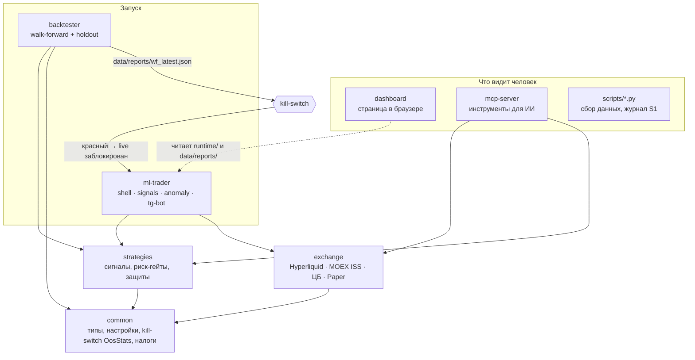

# Торгарик (Torgarik)

[](https://github.com/Bezooom/Torgarik/actions/workflows/ci.yml)


**Торгарик — это учебно-исследовательский проект торгового робота на Rust.**
Он умеет получать цены с бирж, проверять торговые идеи на истории,
торговать «на бумаге» (понарошку, без денег) и показывать всё в браузере.

**Главное, что нужно знать сразу:** проект честно проверил свои стратегии
и показал, что **ни одна из них не зарабатывает стабильно**. Поэтому
торговля настоящими деньгами в нём **заблокирована**. Это не «машина для денег»,
а аккуратный инструмент, который помогает **не потерять** деньги на красивой,
но пустой идее.

> ⚠️ **Не финансовый совет.** Код дан «как есть». Если вы запускаете
> его с настоящими деньгами, вы можете их потерять, и отвечаете за это сами.

---

## Содержание

- [Что это такое простыми словами](#что-это-такое-простыми-словами)
- [Честные результаты](#честные-результаты)
- [Что умеет](#что-умеет)
- [Как устроено](#как-устроено)
- [Быстрый старт](#быстрый-старт)
- [Структура проекта](#структура-проекта)
- [Безопасность и юридические риски](#безопасность-и-юридические-риски)
- [Планы](#планы)
- [Документация](#документация)
- [English summary](#english-summary)
- [Лицензия](#лицензия)

---

## Что это такое простыми словами

Представьте робота, который мог бы сам покупать и продавать криптовалюту.
Прежде чем доверить ему деньги, нужно убедиться, что его правила работают.
Для этого:

1. **Берём старые цены** (историю) и смотрим, что было бы, если бы робот
   торговал по своим правилам в прошлом. Это называется **бэктест**.
2. **Проверяем на «чужих» данных.** Правила подбираются на одной части истории,
   а проверяются на другой, которую робот «не видел». Иначе легко
   «подогнать» правила под прошлое, и в будущем они не сработают.
   Такую проверку называют **OOS** (out-of-sample, «вне выборки»).
3. **Оставляем «последний кусок» истории нетронутым** до самого конца.
   Это самая честная проверка, она называется **holdout** («отложенные данные»).
4. Если хоть одна проверка красная — **предохранитель** (kill-switch)
   не пускает робота торговать настоящими деньгами.

Торгарик делает именно это, плюс ведёт журнал и показывает статус в браузере.

### Маленький словарь

| Слово | Что значит |
|---|---|
| **Бэктест** | Прогон правил робота на старых ценах: «а что было бы, если…» |
| **OOS** | Проверка на куске истории, который не использовали для настройки |
| **Holdout** | Последний кусок истории, на который вообще не смотрели до финала |
| **Walk-forward** | Много таких проверок подряд: настроил на окне — проверил на следующем — сдвинулся |
| **Sharpe (Шарп)** | Оценка «доход против нервов». Меньше 0 — убыток, около 1 — хорошо |
| **PnL** | Прибыль или убыток в деньгах |
| **Просадка** | Насколько счёт падал от пика до дна (например, −23%) |
| **Kill-switch** | Предохранитель: если проверки красные, живая торговля запрещена |
| **Paper / dry-run** | Торговля «на бумаге»: всё как по-настоящему, но без денег |
| **Фьючерс** | Договор на покупку/продажу актива в будущем; на Мосбирже им торгуют, как обычной бумагой |
| **Funding** | Плата между покупателями и продавцами на крипто-фьючерсах без даты окончания |

---

## Честные результаты

### 1. Встроенные стратегии Торгарика (крипта, Hyperliquid)

Предохранитель читает отчёт `data/reports/wf_latest.json`. По нему **живая торговля закрыта**:

| Проверка | Результат | Что значит |
|---|---|---|
| Стратегия `majors_alpha` (тренд по крупным монетам), OOS | **−$466** на $10 000, Sharpe −12 | ❌ убыток |
| Она же, holdout | **−$202** | ❌ убыток |
| Funding carry (заработок на плате funding), OOS | +$103 | ✅ чуть в плюсе |
| Funding carry, holdout | **−$56** | ❌ на свежих данных — убыток |
| Повтор `majors_alpha` (wf_repro), OOS / holdout | +$42 / **−$183** | ❌ не устойчиво |

Важно: эти тесты сделаны на коротком отрезке (около 60 дней часовых свечей),
так что «зелёный» кусок там почти ничего не доказывает. А «красный» holdout —
достаточная причина не включать деньги.

**Вердикт: ❌ не готово к живой торговле.** Это правильное поведение, а не ошибка.

### 2. Отдельное исследование: что реально может работать из России (ноябрь 2026)

Мы проверили 7 идей (и несколько их вариантов) на длинной истории: Мосбиржа — с 2009 года, крипта — с 2019–2020, **заранее записав правила**
(файл с правилами зафиксирован хешем SHA-256 до запуска — чтобы нельзя было
подогнать их задним числом). Правило «зачёта»: не меньше 18 баллов из 25,
не меньше 30 сделок, и плюс **и** на OOS, **и** на holdout.

| Идея | OOS | Holdout (2025–2026) | Баллы | Итог |
|---|---|---|---|---|
| **H1.** Тренд по фьючерсам Мосбиржи (доллар, индекс РТС, нефть, золото, индекс Мосбиржи, газ) | +14.7%/год, Sharpe 0.81, просадка −23% | +17.4%/год, Sharpe 1.27 | 20/25 | ✅ слабый кандидат |
| **H2.** Акции Мосбиржи: покупать те, что росли (моментум) | −3.9%/год | −13.4%/год | 11/25 | ❌ |
| **H3.** Тренд по крупным монетам (Binance) | +37.6%/год | −4.5%/год | 22/25 | ❌ сломался на holdout |
| **H4.** Funding carry (купить монету + продать фьючерс) | +11.1%/год | −0.6%/год | 24/25 | ❌ сломался на holdout |
| **C1.** Крипта: лонг сильных / шорт слабых монет (моментум) | +4.9%/год | +2.9%/год | 18/25 | ⚠️ на грани |
| C1, только покупки | +42%/год | −20.5%/год | 23/25 | ❌ |
| **C2.** Крипта: по величине funding | +2.6%/год | +2.5%/год | 15/25 | ❌ мало баллов |
| **C3.** H3 + фильтр по funding | +23.9%/год | −3.8%/год | 23/25 | ❌ |

**Что из этого следует:**

- Надёжной автоматической стратегии **не нашлось**.
- Единственный слабый кандидат — **H1, тренд по фьючерсам Мосбиржи**.
  Но даже у него «плохой сценарий» (5-й процентиль бутстрепа Sharpe на OOS) ниже нуля.
- Крипто-идея C1 проходит «впритык», после комиссий заработок почти нулевой.
- Красивые цифры на OOS часто разваливаются на свежих данных (H3, H4, C3) —
  именно поэтому holdout обязателен.

Подробно, с цифрами и оговорками: [docs/RESEARCH.md](docs/RESEARCH.md).
Исходные правила и результаты: [research/rf_2026_11/](research/rf_2026_11/).

---

## Что умеет

- **Биржи и данные**
  - Hyperliquid: котировки, funding, история, подпись ордеров (живые ордера заблокированы предохранителем).
  - Мосбиржа (MOEX ISS): только чтение цен, без брокера.
  - Курсы ЦБ РФ (для пересчёта в рубли).
  - Paper-биржа: торговля понарошку с сохранением состояния.
- **Проверка стратегий (backtester)**: walk-forward, holdout, комиссии и проскальзывание,
  проверка «не подглядывает ли стратегия в будущее», поправка на перебор вариантов
  (Deflated Sharpe, PBO), предрегистрация гипотезы хешем.
- **Risk shell (щит)**: лимиты риска, стоп-лоссы, «перерыв» после серии стопов,
  журнал всех событий, удалённая остановка через файл или Telegram.
- **Dashboard**: страница в браузере на `127.0.0.1:8080` — статус, причины блокировки, журнал. Ордеров не ставит.
- **MCP-сервер**: инструменты для ИИ-агентов (котировки, funding, статус предохранителя). Ордеров не ставит.
- **Налоги РФ**: учёт лотов FIFO и расчёт НДФЛ (13/15%) в `common::tax`.
- **Python-скрипты**: сбор истории, ежедневный журнал ручной торговли (S1), уведомления.

---

## Как устроено



Коротко: **backtester** проверяет стратегию и пишет отчёт. **Предохранитель**
(`OosStats::is_blocking()` в `common`) читает отчёт: если Sharpe < 0, или прибыль < 0,
или holdout красный, или в цифрах ошибка (NaN) — **ml-trader** не может
ставить настоящие ордера. Подробнее: [docs/ARCHITECTURE.md](docs/ARCHITECTURE.md).

---

## Быстрый старт

### 1. Что нужно

- Linux или macOS (Windows — через WSL).
- **Rust 1.88 или новее**: установить с [rustup.rs](https://rustup.rs) (`rustup default stable`).
- Пакеты OpenSSL: `sudo apt install pkg-config libssl-dev` (Debian/Ubuntu).
- По желанию: Python 3.10+ для скриптов, `jq`.

### 2. Скачать и собрать

```bash
git clone https://github.com/Bezooom/Torgarik.git
cd Torgarik
cargo build --workspace        # первая сборка ~5–10 минут
cargo test --workspace         # ~180 тестов, все должны пройти
```

### 3. Настройки

```bash
cp .env.example .env           # здесь живут секреты; файл .env в git не попадает
# ничего не заполняйте, чтобы работать только «на бумаге»
set -a; . ./.env; set +a       # загрузить переменные в текущий терминал
```

Обычные настройки (лимиты, монеты, параметры) лежат в `config/dryrun.toml`
(бумага, по умолчанию) и `config/live.toml`. Секретов в них нет и быть не должно.
Подробно: [docs/CONFIG_GUIDE.md](docs/CONFIG_GUIDE.md).

### 4. Проверить стратегию на истории

В репозитории есть маленький пример данных (ETH и SOL, 60 дней по часу):

```bash
cargo run -p backtester -- --walk-forward --alpha trend --preset ethsol \
  --holdout-frac 0.15 --report data/reports/my_test.json
```

В конце будет строка `VERDICT:` — честный вывод, можно ли торговать.
Свежую историю можно собрать скриптом `python3 scripts/collect_hl_history.py --days 60`.

### 5. Торговля на бумаге + страница статуса

```bash
bash scripts/start.sh          # щит (dry-run) + dashboard
# открыть http://127.0.0.1:8080
bash scripts/start.sh status   # что запущено
bash scripts/start.sh stop     # остановить
bash scripts/ready.sh          # «можно ли live?» — почти всегда FROZEN, это нормально
```

Или вручную, в двух терминалах:

```bash
cargo run -p ml-trader -- --mode shell    # щит + журнал, без денег
cargo run -p dashboard                    # страница статуса
```

Нужен интернет: цены берутся с публичного API Hyperliquid.
Новичку — пошаговая инструкция: [docs/ДЛЯ_НОВИЧКОВ.md](docs/ДЛЯ_НОВИЧКОВ.md).

---

## Структура проекта

```text
crates/
  common/        общие типы, настройки, предохранитель OosStats, налоги РФ
  exchange/      Hyperliquid, MOEX ISS (чтение), ЦБ РФ, paper
  strategies/    сигналы (funding, тренд, majors_alpha), риск-гейты, защиты, Келли
  ml-trader/     главный исполняемый файл: shell | signals | anomaly | alpha | tg-bot
  backtester/    walk-forward, holdout, комиссии, аудит «подглядывания», предрегистрация
  dashboard/     локальная страница статуса (только чтение)
  mcp-server/    инструменты для ИИ-агентов (только чтение + статус предохранителя)
config/          dryrun.toml, live.toml, wallets.example.json
data/history/    пример данных ETH/SOL (остальное собирается скриптами)
data/reports/    отчёты walk-forward; wf_latest.json читает предохранитель
docs/            руководства, ADR (архитектурные решения), архив старых разборов
research/        исследования; rf_2026_11/ — проверка 7 идей для РФ
scripts/         запуск, сбор данных, журнал S1, уведомления в Telegram
runtime/         журналы и состояние во время работы (в git не попадает)
models/          место для ML-моделей (в git не попадает)
```

---

## Безопасность и юридические риски

- **Ключи — только в переменных окружения** (`WALLET_PRIVATE_KEY`, `HL_API_PRIVATE_KEY`,
  `TELEGRAM_BOT_TOKEN`). Никогда не кладите их в `config/*.toml` или в git.
  Шаблон — `.env.example`.
- **Живая торговля выключена дважды:** нужно `RUN_MODE=live` + `CONFIRM_LIVE=1` + ключ,
  **и** зелёный отчёт для предохранителя. Сейчас отчёт красный.
- **Hyperliquid** в своих условиях использования относит Россию к **запрещённым территориям**
  (Restricted Territories). Пользоваться им из РФ — юридический риск для вас.
  Binance ушёл из РФ; его архивы исторических данных при этом доступны.
- **Налоги:** доход от торговли в РФ облагается НДФЛ; модуль `common::tax` — помощник, а не консультация.
- Нашли уязвимость? См. [SECURITY.md](SECURITY.md).

---

## Планы

- [x] Честный бэктест с holdout, предрегистрацией и предохранителем
- [x] Исследование РФ-идей на длинной истории ([docs/RESEARCH.md](docs/RESEARCH.md))
- [ ] Вести H1 (фьючерсы Мосбиржи) и C1 (крипто-моментум) на бумаге 2–6 месяцев без изменения правил
- [ ] Адаптер брокера для Мосбиржи (Finam Trade API или Alor OpenAPI) — сначала только бумага
- [ ] Перенести исследовательские Python-скрипты H1/C1 в `backtester` на Rust
- [ ] Привести код к `cargo fmt` и `clippy` без предупреждений
- [x] Удалены устаревшие модули (Polymarket/Limitless/Azuro, copytrader, Hummingbot)

Старый подробный план: [docs/ROADMAP.md](docs/ROADMAP.md).

---

## Документация

| Тема | Файл |
|---|---|
| Для новичков, по шагам | [docs/ДЛЯ_НОВИЧКОВ.md](docs/ДЛЯ_НОВИЧКОВ.md) |
| Первый запуск | [docs/QUICK_START.md](docs/QUICK_START.md) |
| Архитектура | [docs/ARCHITECTURE.md](docs/ARCHITECTURE.md) |
| Результаты исследований | [docs/RESEARCH.md](docs/RESEARCH.md) |
| Как честно бэктестить | [docs/BACKTEST.md](docs/BACKTEST.md), [docs/STATS.md](docs/STATS.md), [docs/PREREG.md](docs/PREREG.md) |
| Щит и риск-гейты | [docs/RISK_SHELL.md](docs/RISK_SHELL.md) |
| Россия: Мосбиржа, рубли, налоги | [docs/RF.md](docs/RF.md), [docs/MONEY_PATH_RF.md](docs/MONEY_PATH_RF.md) |
| Условия разморозки live | [docs/LIVE_UNLOCK.md](docs/LIVE_UNLOCK.md) |
| Настройки | [docs/CONFIG_GUIDE.md](docs/CONFIG_GUIDE.md) |
| Эксплуатация, проблемы | [docs/OPS.md](docs/OPS.md), [docs/TROUBLESHOOTING.md](docs/TROUBLESHOOTING.md) |
| Полный указатель | [docs/README.md](docs/README.md) |
| Как помочь проекту | [CONTRIBUTING.md](CONTRIBUTING.md) |
| История изменений | [CHANGELOG.md](CHANGELOG.md) |

---

## English summary

**Torgarik** is a Rust workspace for *honest* research on automated trading:
market data (Hyperliquid, MOEX ISS read-only, Central Bank of Russia FX), a paper exchange,
a walk-forward backtester with holdout, look-ahead audit, Deflated Sharpe / PBO and hash-based
pre-registration, a risk shell with journal and remote stop, a read-only dashboard and an MCP server.

**Verdict: not ready for live trading.** The built-in crypto strategies lose money out of sample
and on holdout (e.g. `majors_alpha` OOS −$466, holdout −$202 on $10k), so the
`OosStats::is_blocking()` kill-switch keeps live execution frozen. A separate pre-registered study
of 7 ideas (plus variants) over up to 17 years of data found **no robust automated edge**: MOEX futures trend (H1) is a weak
candidate (20/25, OOS Sharpe 0.81, holdout Sharpe 1.27, but bootstrap 5th-percentile OOS Sharpe < 0);
crypto cross-sectional momentum (C1) is marginal (18/25); everything else failed on holdout.
See [docs/RESEARCH.md](docs/RESEARCH.md).

Quick start: `cargo build --workspace && cargo test --workspace` (Rust ≥ 1.88, OpenSSL dev headers),
`cp .env.example .env`, then `bash scripts/start.sh` and open `http://127.0.0.1:8080`.

**Not financial advice.** Hyperliquid lists Russia among its restricted territories.

## Лицензия

На выбор: [MIT](LICENSE-MIT) или [Apache-2.0](LICENSE-APACHE) — стандарт для Rust-проектов.
