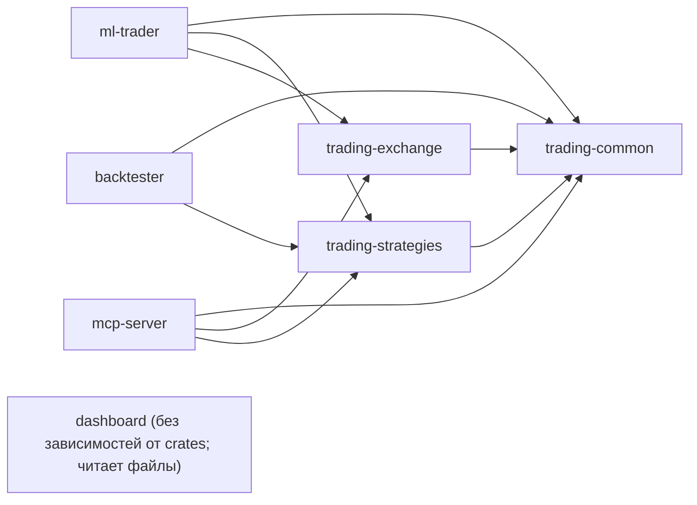
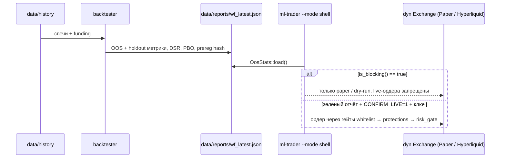

# Архитектура Trading – Advisory Copilot & Risk Shell

## 1. Vision

Проект **Trading** – гибридный контур **S1 (Skill Income) + Risk Shell**:

1. **Основной money path (S1):** ручная торговля оператора. Система – «щит» (лимиты, kill-switch, journal) и «микроскоп» (аномалии, funding rank, quotes).
2. **Automated alpha:** **заморожен** в live, пока multi-fold OOS не покажет стабильный положительный PnL и Sharpe > 0 на holdout / walk-forward.

Целевая площадка: **Hyperliquid** (spot/perp). MOEX ISS – только чтение данных. Других торговых площадок в коде нет: старые клиенты рынков предсказаний (Polymarket и др.) удалены в 0.1.0.

---

## 2. Current state (workspace)

| Crate | Role |
|-------|------|
| `common` | Domain: `Quote`, `OrderRequest`, `PortfolioSnapshot`, `Settings`, `OosStats`, journal helpers, **tax** (FIFO-лоты + НДФЛ) |
| `exchange` | `dyn Exchange` (деньги) + `dyn MarketData` (только чтение), `HyperliquidClient`, `MoexClient` (ISS, read-only), `PaperExchange`, `build_exchange` factory |
| `strategies` | Funding carry, majors_alpha, Kelly, `BetaBelief` (+ `decay`), risk_gate, **protections** |
| `ml-trader` | **Default:** `--mode shell` (RiskShell). Also anomaly logger + experimental alpha |
| `backtester` | WF + holdout + fees/impact/queue + look-ahead audit + DSR/PBO + prereg → schema 1.2 `wf_*.json` |
| `dashboard` | Read-only ops UI: block panel, OOS age, S1, risk_blocks |
| `mcp-server` | HL tools: quotes, funding, portfolio, **kill-switch**, shell status |

Python `scripts/`: S1 discipline, HL history collect, hypothesis analysis.

### Граф зависимостей crates



### Поток данных и предохранитель



### Architectural rules

- Dependencies point **inward**: presentation → execution → risk → decision → data/domain.
- Execution only through `Arc<dyn Exchange>` (`ExchangeHandle`).
- Secrets only via env (`WALLET_PRIVATE_KEY`, `CONFIRM_LIVE`, …); TOML holds public params.
- No `.unwrap()` / `expect()` on `Option`/`Result` in production paths (tests exempt).
- Live auto-alpha blocked when `OosStats::is_blocking()`: Sharpe < 0 **or** PnL < 0 **or** holdout red.
- **Две поверхности площадки.** `MarketData` (list/quote/book) доступна всем, `Exchange` добавляет ордера и портфель. Площадка без пути ордера (MOEX ISS) реализует только `MarketData`; `dyn Exchange` по-прежнему видит всё: blanket impl транслирует `Exchange` в `MarketData`.
- **Protections до risk_gate.** Порядок гейтов: whitelist → protections → `check_order`. Закрытия (reduce_only) не блокируются никогда.
- **Point-in-time.** Бэктест обязан пройти look-ahead audit (prefix-replay даёт бит-в-бит тот же сигнал); `--as-of` фиксирует «мир на дату».
- **Selection bias в kill-switch.** Отчёт несёт `deflated_sharpe_min` и `pbo_avg`; `OosStats` блокирует live при DSR <= 0 или PBO > 0.5. Отчёты без этих полей читаются по-старому.
- **Один генератор сигналов.** `strategies::signals` вызывают и бэктестер, и `ml-trader --mode signals`; второй пишет строки в `runtime/signals.jsonl`, которые проходит shell со всеми гейтами.
- Journal events carry `version` (major-compat fail-soft); shell signal offset = EOF at start.
- Report kill-switch source: `data/reports/wf_latest.json` (override `WF_REPORT_PATH`).

---

## 3. Target layers

```
+-----------------------------------------------------------------------+
| Presentation                                                          |
|   dashboard  |  mcp-server (HL tools)  |  S1 Python scripts           |
+-----------------------------------+-----------------------------------+
                                    v
+-----------------------------------------------------------------------+
| Execution                                                             |
|   Arc<dyn Exchange>  |  HyperliquidClient  |  PaperExchange           |
|   factory::build_exchange / build_exchange_pair                       |
+-----------------------------------+-----------------------------------+
                                    v
+-----------------------------------------------------------------------+
| Risk                                                                  |
|   RiskShell  |  protections  |  risk_gate  |  OOS kill-switch      |
|   bracket monitor (SL/TP)  |  daily loss                              |
+-----------------------------------+-----------------------------------+
                                    v
+-----------------------------------------------------------------------+
| Decision / Research                                                   |
|   funding / majors_alpha  |  Kelly  |  BetaBelief  |  backtester      |
|   tax (FIFO, НДФЛ)        |  MOEX candles / ISS quotes                |
+-----------------------------------+-----------------------------------+
                                    v
+-----------------------------------------------------------------------+
| Data                                                                  |
|   JSONL journal  |  data/history  |  data/reports/wf_*.json           |
|   runtime/paper_state.json  |  runtime/protections.json             |
+-----------------------------------------------------------------------+
```

**S1 is first-class presentation**, not a side script: operator → signals/intents → RiskShell → (optional) execution → journal → dashboard.

---

## 4. Data flows

### Research
Python collector → `data/history` → Rust walk-forward → `data/reports/wf_latest.json` → dashboard + `OosStats`.

### Trading / advisory
Signal or manual intent → RiskShell (OOS + limits) → `dyn Exchange` place/cancel → journal → dashboard.

---

## 5. Known debt (ordered by money-path impact)

| Priority | Item | Notes |
|----------|------|--------|
| P0–P4 | See [ROADMAP.md](./ROADMAP.md) | Build → shell → ops → realism → e2e |
| Done | Parallel HL market refresh | `tokio::join!` allMids + meta |
| Backlog | Cache consolidation / DashMap | Perf only |
| Backlog | External alerts | After journal (local remains SoT) |
| Done | Deflated Sharpe / PBO | `stats.rs` + гейты A1/A9 |
| Done | Единый signal-engine backtest/shell | `strategies::signals` + `--mode signals` |
| Done | Pre-registration гипотезы | `prereg.rs`, `--prereg-only` / `--prereg-expect` |
| Done | Remote stop flag + Telegram control | `kill_flag.rs`, `tg_control.rs` |
| Backlog | РФ-брокер (Tinkoff/Alor) | Нужны боевые ключи и `Broker` trait; без них адаптер непроверяем |
| Backlog | Сплиты MOEX | Дивиденды есть, дробление акций нет |

---

## 6. Standards

### Errors
Map to `TradingError`. Float sorts: `partial_cmp(...).unwrap_or(Ordering::Equal)`.

### Logging
`tracing` with structured fields (`coin`, `size`, …).

### Config
`Settings` in `crates/common/src/config.rs`. Live requires `CONFIRM_LIVE=1` + wallet key; OOS red hard-blocks Live.

---

## 7. Risk mitigation

| Risk | Mitigation |
|------|------------|
| Overfit OOS “green” | Holdout + multi-fold; don’t unlock live on single grid-search window |
| API panic / schema drift | `Result` everywhere; journal version; no silent schema wipe of equity curves |
| RF network / geo | Opt-in HTTP/SOCKS proxy on HL client only |
| Alert channel down | Local journal remains source of truth |

---

## 8. Non-goals (near term)

- Multi-venue PM production path
- Live auto-alpha while OOS red
- Heavy JSON-Schema infra before simple journal versioning
- Perf gates (BinaryHeap, −30% latency) as phase blockers
