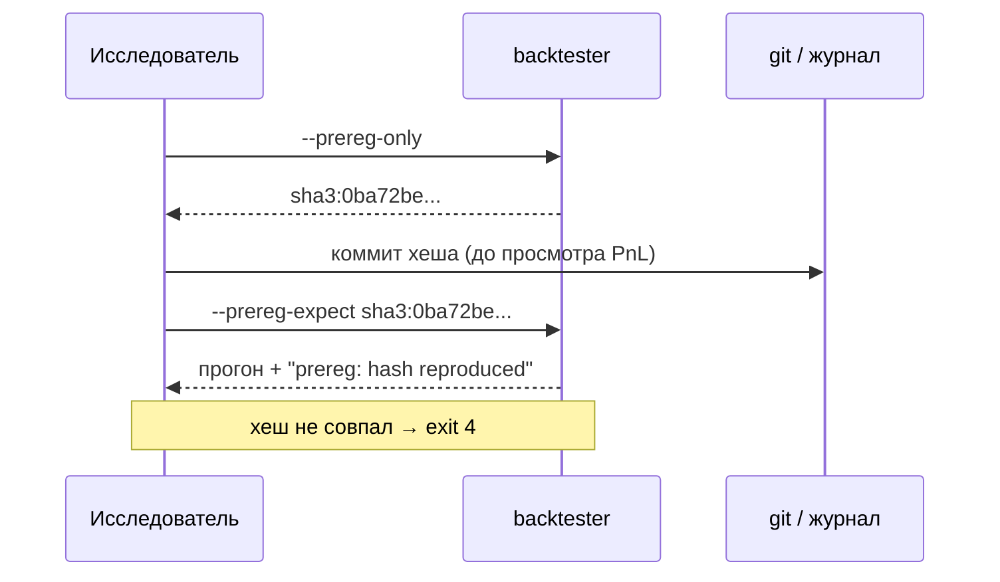

# Pre-registration: фиксация гипотезы до результата

**Инвариант.** Гипотеза фиксируется хешем **до** просмотра PnL. Прогон, чей хеш не
совпадает с зафиксированным, помечается как «гипотеза изменилась после факта» и
не может быть основанием для разморозки live.

Код: `crates/backtester/src/prereg.rs`.

## 1. Зачем

Deflated Sharpe внутри прогона видит только сетку **этого** прогона. Он не видит,
что вы вчера поменяли `holdout_frac`, позавчера – сетку, а сегодня «нашли
работающий вариант». Именно так и появляется overfitting, которого нет ни в одном
отчёте.

Pre-registration делает это видимым: хеш зависит от гипотезы и от данных, поэтому
любое изменение после факта даёт другой хеш.

## 2. Что входит в хеш

| Поле | Почему |
|---|---|
| `alpha` | funding и trend – разные гипотезы |
| `capital`, `n_folds`, `train_frac`, `expanding`, `embargo_bars`, `holdout_frac` | окно и протокол отбора |
| `funding_grid`, `trend_pairs`, `trend_*` | сама сетка параметров |
| `exec` | модель издержек: slip, impact, taker, queue delay |
| `data[]` | по каждой монете: имя, число баров, первый и последний `ts` |

Отпечаток данных – это не содержимое баров, а границы и длина ряда. Этого
достаточно, чтобы заметить «докачали ещё месяц истории и пересчитали».

## 3. Рабочий цикл



```bash
# 1. до результата: получить хеш и сохранить его
cargo run -p backtester -- --walk-forward --alpha trend --preset ethsol --prereg-only

# 2. после: прогон обязан воспроизвести хеш
cargo run -p backtester -- --walk-forward --alpha trend --preset ethsol \
  --prereg-expect sha3:0ba72be83c59f213723ee3b52a4b5c32ea0270b2cadc07cb0288aff138542f6a \
  --report data/reports/wf_latest.json
```

## 4. Коды выхода

| Код | Значение |
|---|---|
| 0 | прогон прошёл, хеш совпал |
| 2 | неверный `--as-of` |
| 3 | look-ahead audit провален |
| 4 | pre-registration mismatch |

Коды специально разные: CI и оператор должны различать «плохие данные»,
«утечка будущего» и «гипотеза поменялась».

## 5. Что хеш не покрывает

1. Код стратегии. Меняется реализация `trend_plan` – хеш тот же. Поэтому рядом
   живёт look-ahead audit и обычные тесты сигналов.
2. Внешние условия (комиссии биржи, режим рынка).
3. Число **разных** гипотез, которые вы прогнали за месяц. Это дисциплина, а не
   автоматика: храните хеши в git или в `docs/prereg.log` рядом с датами.

## 6. Проверки

```bash
cargo test -p backtester --lib prereg
```

Тесты фиксируют три свойства: хеш стабилен при одинаковых входах, меняется при
изменении гипотезы, меняется при изменении данных (длина ряда и сдвиг `ts`).
