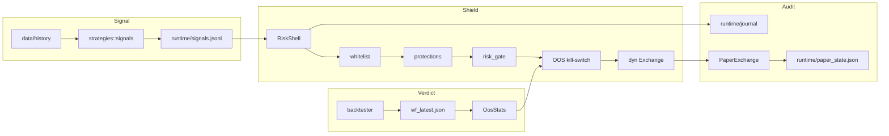

# Документация Torgarik

Один вход во всю документацию. Каждый документ отвечает на один вопрос и не
пересказывает соседей.

## Правила этих документов

1. **Инвариант, потом детали.** Любой документ начинается с того, что нельзя
   нарушать, и только потом объясняет, как это сделано.
2. **Проверяемость.** Команда или файл, которыми утверждение подтверждается,
   указаны рядом с утверждением. Если проверить нечем – так и написано.
3. **Без обещаний.** «Должно работать» не пишем: либо работает и это видно, либо
   это backlog с явной причиной.
4. **Один факт в одном месте.** Остальные документы ссылаются, а не копируют.

## С чего начать

| Документ | Кому |
|---|---|
| [QUICK_START.md](QUICK_START.md) | первый запуск за 5 минут |
| [ДЛЯ_НОВИЧКОВ.md](ДЛЯ_НОВИЧКОВ.md) | объяснение «зачем это вообще» без терминов |
| [GUIDE.md](GUIDE.md) | ежедневный рабочий цикл оператора |
| [TIPS.md](TIPS.md) | частые ошибки и как их не делать |

## Как устроено

| Документ | О чём |
|---|---|
| [ARCHITECTURE.md](ARCHITECTURE.md) | слои, зависимости, инварианты, поток данных |
| [RISK_SHELL.md](RISK_SHELL.md) | гейты, journal, брекеты, protections, stop-флаг |
| [LIVE_UNLOCK.md](LIVE_UNLOCK.md) | чеклист разморозки live, точка отказа |
| [MONEY_PATH_RF.md](MONEY_PATH_RF.md) | РФ-ограничения, география, провайдеры |

## Честность исследования

| Документ | О чём |
|---|---|
| [BACKTEST.md](BACKTEST.md) | walk-forward, реалистичные издержки, holdout |
| [STATS.md](STATS.md) | deflated Sharpe, PBO, ожидаемый максимум: математика и пороги |
| [RESEARCH.md](RESEARCH.md) | сводка всех проверок стратегий и исследование РФ-идей (ноябрь 2026) |
| [PREREG.md](PREREG.md) | как зафиксировать гипотезу до просмотра результата |
| [DATA.md](DATA.md) | история, формат баров, point-in-time, отпечаток данных |

## Эксплуатация

| Документ | О чём |
|---|---|
| [OPS.md](OPS.md) | runbook: старт, стоп, cron, алерты, инциденты |
| [DASHBOARD.md](DASHBOARD.md) | что показывает локальный UI и откуда берёт данные |
| [CONFIG_GUIDE.md](CONFIG_GUIDE.md) | все ключи `config/*.toml` и их влияние |
| [TROUBLESHOOTING.md](TROUBLESHOOTING.md) | диагностика по симптому |
| [VENUE_SMOKE.md](VENUE_SMOKE.md) | проверка площадки перед работой |
| [API.md](API.md) | MCP-инструменты, `/api/status`, форматы journal и signals |

## РФ-контур

| Документ | О чём |
|---|---|
| [RF.md](RF.md) | MOEX ISS, RUB, НДФЛ, ИИС-3, курс ЦБ |
| [S1_SHELL_INCOME.md](S1_SHELL_INCOME.md) | S1 как основной источник дохода |
| [L1_LEADERBOARD.md](L1_LEADERBOARD.md) | наблюдение за кошельками (read-only) |

## Инженерия

| Документ | О чём |
|---|---|
| [TESTING.md](TESTING.md) | карта тестов, что обязано быть зелёным, сетевые тесты |
| [SECURITY.md](SECURITY.md) | секреты, поверхность удалённого управления, модель угроз |
| [CHANGELOG.md](CHANGELOG.md) | что изменилось по фазам |
| [ROADMAP.md](ROADMAP.md) | фазы 0–6, что сделано и что в backlog |
| [adr/](adr/README.md) | Architecture Decision Records: почему так, а не иначе |

## Диаграмма связей

